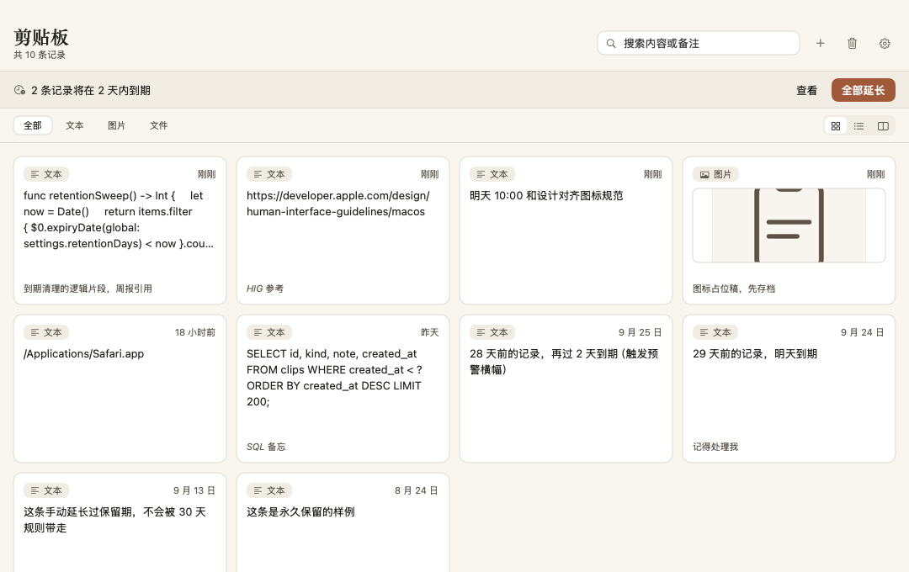
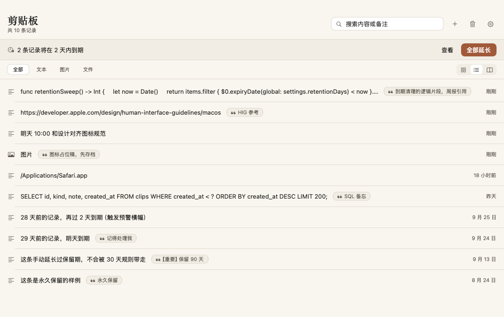
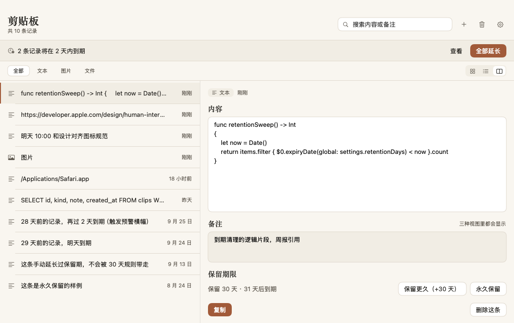

# CutBoardar

**macOS 剪贴板历史管理器。** 常驻菜单栏，自动记住你复制过的文本、图片和文件路径，随时搜索、编辑、备注与清理 —— 不申请辅助功能、屏幕录制这类敏感权限。

*Native SwiftUI + AppKit clipboard history for macOS. Menu bar resident, zero permissions, 1.6 MB single binary.*

<p align="center">
  
  
  
  
</p>

<p align="center">
  
</p>
<p align="center"><sub>图标视图：每条记录一张卡片，一眼扫过全部历史</sub></p>

## 为什么是它

- **零授权**：靠轮询 `NSPasteboard` 的 `changeCount` 工作，不注入其它进程，不申请「辅助功能」「屏幕录制」这类权限。
- **轻**：原生 SwiftUI + AppKit，无第三方依赖，可执行文件 1.6 MB，双击即启动。
- **安静**：常驻菜单栏，需要时 ⇧⌘V 呼出，不需要时不占视线。

## 特性

| 能力 | 说明 |
| --- | --- |
| 自动记录 | 后台每 0.4 秒检查一次 `changeCount`，文本、图片、文件路径都会被收下，复制和剪切都算 |
| 搜索与增删改 | 关键词即时过滤，回车复制首条；可编辑原文、删除单条、一键清空 |
| 备注 | 给任意一条记录写一句话，标记「报价单」「客户地址」这类用途 |
| 30 天保留 | 默认保留 30 天，到期前 3 天在应用内显示横幅并推送系统通知 |
| 单条延长 | 任意一条都能单独延长保留期，或设为永久不清理 |
| 三种视图 | 图标 / 列表 / 分栏，按场景随时切换 |
| 菜单栏常驻 | 菜单栏图标 + 全局热键 ⇧⌘V 随时呼出并聚焦搜索 |
| 单文件产物 | 打包出 1.6 MB 的 `CutBoardar.app`，无运行时依赖，拷走就能跑 |

## 三种视图

<p align="center">
  
</p>
<p align="center"><sub>列表视图：一屏看到更多记录，适合按时间翻找</sub></p>

<p align="center">
  
</p>
<p align="center"><sub>分栏视图：左侧选记录，右侧看全文、写备注</sub></p>

三张图依次对应**图标视图**、**列表视图**、**分栏 + 备注编辑**。右上角三个按钮切换视图；网格或列表里右键某条记录选「编辑与备注」会跳到分栏详情。

## 快速开始

**直接用**：到 [Releases](https://github.com/OranJu086/CutBoardar/releases/latest) 下载 `CutBoardar-1.0.0-macOS-arm64.zip`，解压后把 `CutBoardar.app` 拖进「应用程序」文件夹。首次打开可能被 Gatekeeper 拦一次，处理方式见下方 FAQ。

**从源码构建**：macOS 14.0 及以上、Apple Silicon，并已安装命令行工具（`xcode-select --install`）。不需要 Xcode，也不需要 Homebrew。

```bash
git clone https://github.com/OranJu086/CutBoardar.git
cd CutBoardar
./run.sh          # 构建并启动；只需要产物就改用 ./build.sh
```

产物在 `dist/CutBoardar.app`，拖进「应用程序」文件夹即可日常使用。首次打开可能被 Gatekeeper 拦下，处理方式见下方 FAQ。

## 快捷键

| 快捷键 | 作用 |
| --- | --- |
| ⇧⌘V | 全局呼出主窗口并聚焦搜索（在任何 App 里都生效） |
| ⌘F | 聚焦搜索框 |
| ↩（搜索框内） | 复制第一条匹配结果 |
| ⇧⌘C | 复制当前选中记录 |
| ⌘⌫ | 删除选中记录 |
| ⌘N | 手动新增一条记录 |
| ⇧⌘⌫ | 打开清理面板 |
| ⌘, | 打开设置 |
| Esc | 关闭弹层 / 取消 |

视图切换、筛选、备注编辑也都可以用鼠标完成。

## 换图标

1. 准备一张 1024×1024 的 PNG，覆盖 `Assets/AppIcon.png`
2. `./Tools/build_icon.sh` 生成 `Assets/AppIcon.icns`
3. `./build.sh` 重新打包
4. `killall CutBoardar; open dist/CutBoardar.app` 重开，Dock 和访达里的图标随之更新

> 只跑 `build.sh` 不会重绘图标 —— 它拷进 bundle 的是 `Assets/AppIcon.icns`，`build_icon.sh` 才是「源图 → icns」那一步。已经有现成 icns 的话，直接覆盖该文件再 `./build.sh` 即可（保持 `CFBundleIconFile=AppIcon` 对应的文件名）。想回到出厂图标：`./Tools/build_icon.sh --regen-source`。

## 数据与备份

所有数据都在：

```
~/Library/Application Support/CutBoardar/
├── store.json   # 记录与设置
└── images/      # 图片记录的落盘文件
```

- **备份**：退出 App，把整个 `CutBoardar` 文件夹复制到别处
- **恢复**：退出 App，把备份的文件夹放回原位
- **清空**：退出 App 后删除该文件夹；或只在 App 内「一键清理」，只清记录、保留设置

## 常见问题

### 首次打开提示「无法验证开发者」

App 用 ad-hoc 签名，没有开发者证书，Gatekeeper 会拦一次。任选一种：

- 系统设置 → 隐私与安全性 → 找到「CutBoardar 已被阻止打开」→ 点「仍要打开」
- Finder 里按住 Control 点击 App → 打开 → 打开

### ⇧⌘V 按了没反应

热键用 Carbon `RegisterEventHotKey` 注册，**不需要**「辅助功能」权限。所以问题通常是热键被别的应用占了（先退出可能的启动器再试）。启动日志里出现 `全局热键 ⇧⌘V 注册失败` 就是冲突了。想确认是否注册成功：

```bash
log show --predicate 'process == "CutBoardar"' --last 2m | grep 热键
```

没有输出说明注册成功。

### 想让它开机自启

设置面板（⌘,）里有「开机自启」开关，打开即可，它会在 `~/Library/LaunchAgents` 下写一个 LaunchAgent；如果当前环境不允许写该目录，开关下方会直接给出原因。

也可以用系统自带的「登录项」：系统设置 → 通用 → 登录项 → 添加 `CutBoardar.app`。

想手动管理的话，自己写一个 LaunchAgent（路径换成你实际的 App 位置）：

```bash
cat > ~/Library/LaunchAgents/com.cutboardar.app.plist <<'PLIST'
<?xml version="1.0" encoding="UTF-8"?>
<!DOCTYPE plist PUBLIC "-//Apple//DTD PLIST 1.0//EN" "http://www.apple.com/DTDs/PropertyList-1.0.dtd">
<plist version="1.0"><dict>
  <key>Label</key><string>com.cutboardar.app</string>
  <key>ProgramArguments</key>
  <array><string>/usr/bin/open</string><string>-a</string><string>/Applications/CutBoardar.app</string></array>
  <key>RunAtLoad</key><true/>
</dict></plist>
PLIST
launchctl load ~/Library/LaunchAgents/com.cutboardar.app.plist
```

取消：`launchctl unload ~/Library/LaunchAgents/com.cutboardar.app.plist`，再删掉那个 plist。

### 复制的图片存在哪里

落在 `~/Library/Application Support/CutBoardar/images/`，`store.json` 里存它们的元数据。别单独删这个目录，否则对应的图片记录会变成空白条目；整目录备份才是完整的备份。

### 构建失败

- 报「没有找到任何 .swift 文件」：`Sources/Core` 与 `Sources/App` 下没有源码
- 报 SDK 相关错误：确认用的是脚本里固定的 `MacOSX15.4.sdk`，别手动改回默认 SDK
- 报 `Permission denied`：`chmod +x build.sh run.sh Tools/build_icon.sh`

## 构建原理

这台机器上没有 Xcode，只有 Command Line Tools，所以不走 Xcode 工程，而是用 `swiftc` 直接编译 `Sources/**/*.swift`，再手工组装 `.app` bundle（`Contents/MacOS`、`Info.plist`、`Resources/AppIcon.icns`、`PkgInfo`）并做 ad-hoc 签名。默认 SDK 与 `swiftc` 的版本并不匹配，因此 `build.sh` 固定使用 `-sdk /Library/Developer/CommandLineTools/SDKs/MacOSX15.4.sdk -target arm64-apple-macos14.0`，模块缓存也固定写到 `./.build/mc`。手动编译时请保持一致，否则会撞上 SDK 报错。

## 已知限制

- ad-hoc 签名、未公证：本机可双击运行，分发给别人时对方要走上面的「仍要打开」流程，正式分发需要自己的开发者证书重新签名
- 只有 arm64 产物：Intel Mac 需把 `-target` 改成 `x86_64-apple-macos14.0` 重新编译
- 未做多语言：界面文案目前只有中文
- 多选文件复制会被拆成多条记录，而不是一条「多路径」记录

## 许可证与致谢

以 [MIT 许可证](LICENSE) 发布，可自由使用、修改与再分发。

作者 / 维护者：[@OranJu086](https://github.com/OranJu086)。贡献者同样记在该账号名下。
